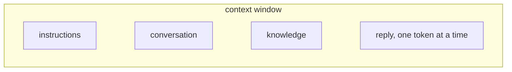

import { TabItem, Tabs } from '@astrojs/starlight/components';
import ChapterLink from '~/components/ChapterLink.astro';
import Define from '~/components/Define.astro';

What does the model actually see?

## If it's not in the window, it doesn't exist

On each call, the model has a fixed amount of space to work in, called its <Define term="context-window">context window</Define>. Claude Opus 5.5's holds [a million tokens](https://platform.claude.com/docs/en/build-with-claude/context-windows). Think of it as a window: the model sees what's inside the frame, and nothing outside it reaches the model.

The model is stateless, so the context window starts empty on every call, and your request fills it. Anything the model should use, your program puts in the context window.

Three kinds of text fill most context windows:

<Tabs>
	<TabItem label="Instructions">

Instructions say what to do with the request. They go in a message with a role of their own, `system`, and apply to the rest of the conversation. Here is the question from <ChapterLink id="part-1-primitives/what-is-a-model" />, with instructions added:

```python
messages = [
    {"role": "system", "content": "Answer in one sentence, in French."},
    {"role": "user", "content": "Explain what an API is."},
]
# "Une API est un ensemble de règles qui permet à un programme de demander des données ou des actions à un autre programme."
```

The model is the same, and the question is the same. The context window changed, so the output changed with it.

	</TabItem>
	<TabItem label="Conversation">

The conversation is every message so far. Here is Ada's:

```python
messages = [
    {"role": "user", "content": "My name is Ada."},
    {"role": "assistant", "content": "Nice to meet you, Ada."},
    {"role": "user", "content": "What's my name?"},
]
# "Your name is Ada."
```

The model answers as if it remembered, because the earlier messages are in the context window. Your program put them there.

	</TabItem>
	<TabItem label="Knowledge">

Knowledge is the facts the answer needs. Ask "Should I take an umbrella in Paris today?" on its own, and the model has nothing to answer from. Today's weather isn't in its training data, and it isn't in the request. So your program looks it up and adds it in a `system` message:

```python
weather = get_weather("Paris")  # your code, calling a weather API
# "14°C, light rain"

messages = [
    {"role": "system", "content": f"Current weather in Paris: {weather}"},
    {"role": "user", "content": "Should I take an umbrella in Paris today?"},
]
# "Yes. There's light rain in Paris right now, so take an umbrella."
```

The user's question stays as they typed it, and the fact sits next to it in the context window. The answer comes from the context window, not from training data. To have the model use a fact, put the fact in the context window.

	</TabItem>
</Tabs>

The reply goes in the context window too. The model predicts each token from all the text before it, and then adds that token to the end. Every token of the reply becomes part of the context window that the next token is predicted from.



{/*
Next, per the agreed outline:

## How big is the world?
The limit is counted in tokens and covers input and output, so `max_tokens` takes room from it.
Ada's conversation grows until a request no longer fits: an error, or `stop_reason`.
Cards for every option: drop old messages, summarize them, start a new conversation,
send only what the call needs, pick a model with a bigger window.

## Is a bigger world better?
Cost, latency, and quality cards, each with its fix.
Close: choosing what goes into the context window is the rest of the book.
*/}
