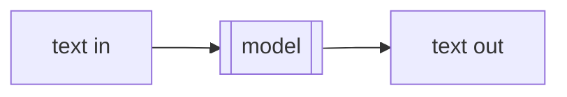
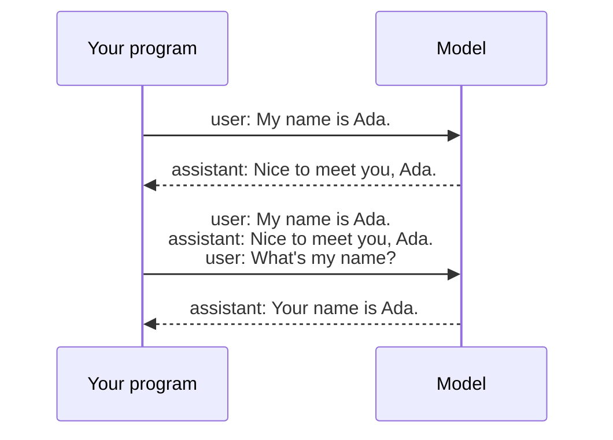
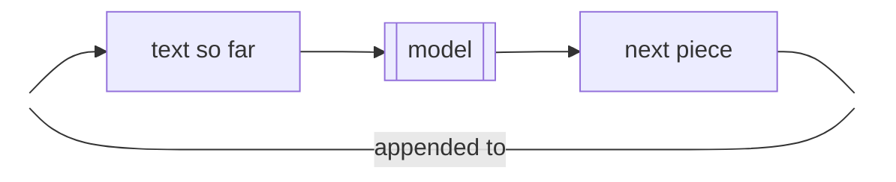

import { Aside, Card, CardGrid, TabItem, Tabs } from '@astrojs/starlight/components';
import ChapterLink from '~/components/ChapterLink.astro';
import Define from '~/components/Define.astro';
import NextTokenPlayer from '~/components/NextTokenPlayer';
import Draft from '~/components/Draft.astro';
import SectionLink from '~/components/SectionLink.astro';

LLM? wtf is that?

## A model is a black box

From the outside, a <Define term="model">model</Define> is a function. You give it some text, and it gives you some text back.



That's the whole interface. Chat apps, coding agents, and assistants that browse the web are all built on it. None of them change what happens inside the model. They change what text goes in, and what happens to the text that comes out.

For instance:

| Model | Made by | The maker's app |
|---|---|---|
| [Claude Opus 5.5](https://www.anthropic.com/claude/opus) | Anthropic | Claude |
| [GPT-6 Astra](https://developers.openai.com/api/docs/models) | OpenAI | ChatGPT |
| [Gemini 4 Argon](https://ai.google.dev/gemini-api/docs/latest-model) | Google | Gemini |
| [Mistral Large 4](https://docs.mistral.ai/models) | Mistral | Le Chat |
| [Muse Spark Open](https://huggingface.co/meta-models/Muse-Spark-Open-816B-A42B) | Meta | None. You download it and run it yourself. |

ChatGPT is not a model. It's an app, and the model inside it is one of OpenAI's GPT models. In the same way, Claude is an app, and Claude Opus is a model. When someone says "I asked ChatGPT", they sent text to a GPT model through an app.

Some models are open source or open weights, and you can run them yourself. Others are proprietary, and you can only use them through an app or API.

So for most of this book, the model stays a black box. You can build agents without knowing its internals. The questions that matter are about its input and its output. What do you send? What do you get back? What does your program do with it?

Two facts matter from the start:

<CardGrid>
	<Card title="You control the input" icon="pencil">
		Prompting, context, and instructions all come down to choosing what text to send.
	</Card>
	<Card title="The output is always text" icon="document">
		Prose, JSON, code, or a request to run a function. It's all text, and your program decides what it means.
	</Card>
</CardGrid>

Many models also accept images and audio, and some produce them. The idea stays the same. This book sticks to text, because agents read and write text.

## Calling the model

Most models run on someone else's servers. You call them over HTTP. You send a request that contains your text, and you get back a response that contains the model's text.

Here is a call to Claude Opus 5.5, first as a raw HTTP request and then with Anthropic's Python library. Both send the same request.

<Tabs>
	<TabItem label="HTTP">

```bash
curl https://api.anthropic.com/v1/messages \
  -H "Content-Type: application/json" \
  -H "x-api-key: $ANTHROPIC_API_KEY" \
  -H "anthropic-version: 2026-10-21" \
  -d '{
    "model": "claude-opus-5-5",
    "max_tokens": 16000,
    "messages": [
      {"role": "user", "content": "Explain what an API is in one sentence."}
    ]
  }'
```

	</TabItem>
	<TabItem label="Python">

```python
import anthropic

client = anthropic.Anthropic()  # reads ANTHROPIC_API_KEY

messages = [{"role": "user", "content": "Explain what an API is in one sentence."}]
response = client.messages.create(
    model="claude-opus-5-5", max_tokens=16000, messages=messages
)

for block in response.content:
    if block.type == "text":
        print(block.text)  # "An API is a set of rules that lets one program ask another program for data or actions."
```

	</TabItem>
</Tabs>

The request has three parts that matter:

- `model` says which model to call.
- `max_tokens` caps how much text the model can send back.
- `messages` is your text.

<span id="the-response" />The response is JSON. Trimmed to the parts that matter here, it looks like this:

```json title="Response (trimmed)"
{
  "model": "claude-opus-5-5",
  "content": [
    {
      "type": "text",
      "text": "An API is a set of rules that lets one program ask another program for data or actions."
    }
  ],
  "stop_reason": "end_turn",
  "usage": { "input_tokens": 16, "output_tokens": 21 }
}
```

The model's answer is in `content`, which is a list of blocks. The block with `"type": "text"` holds the text. Everything else is bookkeeping. `stop_reason` says why the model stopped, and `usage` says how much text went in and came out.

<Aside type="caution" title="Usage is what you pay for">
Model providers charge for the text that goes in and the text that comes out, as counted in `usage`. Every call costs money, and a longer request costs more.
</Aside>

## Who _are_ you?

Chat apps make it look like the model remembers what you said. It doesn't. Every call starts from nothing. The model sees the text in that one request and nothing else. A model that keeps nothing between calls is called <Define term="stateless">stateless</Define>.

You can see this with two separate calls. Send "My name is Ada." in the first call, and "What's my name?" in the second. The second request contains only the question, so the model has no way to know the answer.

So how does a chat work? The app keeps the conversation and sends all of it on every call. Each piece of the conversation is a <Define term="message">message</Define>, and each message has a <Define term="role">role</Define>. Text you send has the role `user`. Text the model sent back has the role `assistant`.



In code, the conversation is a list of messages that grows by one message each time:

```python ins={11,14}
import anthropic

client = anthropic.Anthropic()

messages = [{"role": "user", "content": "My name is Ada."}]
response = client.messages.create(
    model="claude-opus-5-5", max_tokens=16000, messages=messages
)

# Keep the model's reply in the conversation.
messages.append({"role": "assistant", "content": response.content})

# Ask the follow-up. This request carries all three messages.
messages.append({"role": "user", "content": "What's my name?"})
response = client.messages.create(
    model="claude-opus-5-5", max_tokens=16000, messages=messages
)

for block in response.content:
    if block.type == "text":
        print(block.text)  # "Your name is Ada."
```

The code appends the whole reply as it came back, not only its text. A reply can carry more than text, and the next request sends it back unchanged.

The second request contains the whole conversation, so the model answers as if it remembered. The memory lives in your program, not in the model.

This has a cost. The request gets longer with every message, and `usage` counts every message again on every call. <ChapterLink id="part-1-primitives/context-window" /> covers how long a conversation can get.

## What's in the box?

You don't need the model's internals to build with it, but a peek inside explains a lot of what you'll see.

A model doesn't write its answer all at once. It reads all the text it was given and predicts one small piece of text that comes next. Then it adds that piece to the end and predicts the next one. It repeats this until it predicts that the answer is over, or until it reaches a limit.



These pieces are called <Define term="token">tokens</Define>. A token is often a word or part of a word. The numbers in `usage` are counts of tokens, so tokens are what you pay for.

The model learned which pieces tend to follow which from the huge amount of text it was trained on. That's all "predict" means here: given this text, what comes next?

Here is the loop producing the reply from <SectionLink id="calling-the-model" />. At each step, the model gives every token it knows a probability of coming next. In this example, the most likely token is added each time. The numbers are made up for illustration.

<NextTokenPlayer client:visible />

This loop explains two fields from [the response](#the-response) in <SectionLink id="calling-the-model" link={false} />. `max_tokens` is the limit on how many tokens the model can add. `stop_reason` says how the loop ended. `"end_turn"` means the model predicted the end of its answer, and `"max_tokens"` means it reached the limit first.

It also explains why chat apps show answers a few words at a time. Because the model produces its answer one token at a time, the API doesn't have to wait for the end. It can send each token as soon as the model produces it, and the app displays each one as it arrives. A response sent this way is called a <Define term="streaming">streaming</Define> response. You ask for one by adding `"stream": true` to the request.

<Draft>

## What can the model do?

A model is a function from text to text. Each card below follows from that, along with how you work with it.

<CardGrid>
	<Card title="It describes actions" icon="rocket">
		The model outputs text, and some of that text can describe an action, like a web search. Your program reads the description and runs the action. <ChapterLink id="part-2-model-to-agent/tools" /> shows how.
	</Card>
	<Card title="It answers from its training data and your request" icon="open-book">
		The training data ends at the model's <Define term="knowledge-cutoff">knowledge cutoff</Define> and never includes your files or today's date. To get answers from them, put them in the request, either directly or looked up from a knowledge base. <ChapterLink id="part-3-building-and-judging/context-engineering" /> covers what to include.
	</Card>
	<Card title="It outputs likely text" icon="warning">
		Likely text is usually correct. When it isn't, the output is a fluent, wrong answer called a <Define term="hallucination">hallucination</Define>. A request that contains the facts the answer needs makes hallucinations less likely. Checking the output catches the rest, and <ChapterLink id="part-3-building-and-judging/evals" /> shows how.
	</Card>
	<Card title="Its output varies between runs" icon="random">
		Most APIs pick each token at random, weighted by its probability, so the same request can return different text. This makes the model <Define term="non-determinism">non-deterministic</Define>. A lower `temperature`, where the API offers one, reduces the variation. Judge a program on many runs, not one.
	</Card>
</CardGrid>

</Draft>
